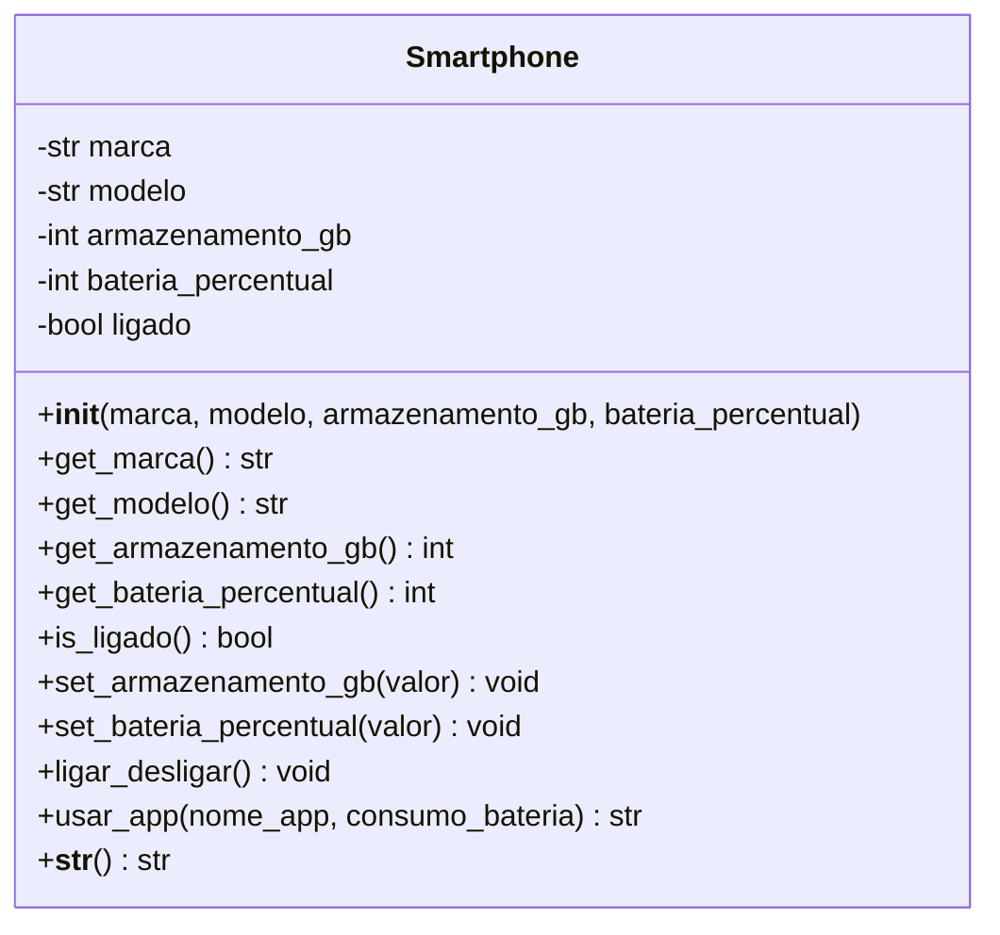

# 📱 Exercício 1 — Smartphone e Módulos

**Objetivo:** Praticar criação de classe, encapsulamento (*getters/setters*), métodos simples e separação em módulos.

## Enunciado

Crie uma classe chamada `Smartphone` em um arquivo chamado `smartphone.py`.

- **Atributos:** `marca`, `modelo`, `armazenamento_gb`, `bateria_percentual` (de 0 a 100) e `ligado` (booleano, inicia como `False`).
- **Métodos:**
  - Construtor (`__init__`).
  - *Getters* para todos os atributos.
  - *Setters* para `armazenamento_gb` e `bateria_percentual` (garantindo que a bateria fique entre 0 e 100).
  - `ligar_desligar()`: alterna o estado do aparelho (se estava desligado, liga — desde que tenha bateria maior que 0 — e vice-versa).
  - `usar_app(nome_app, consumo_bateria)`: se o aparelho estiver ligado e tiver bateria suficiente, reduz a bateria e retorna `"Usando o app: <nome_app>"`. Caso contrário, retorna uma mensagem informando o problema (desligado ou sem bateria).
  - `__str__()` (equivalente ao `toString()`): retorna uma descrição completa do smartphone.

No arquivo `main.py`, crie uma função `criar_smartphones()` que peça os dados de **2 aparelhos** ao usuário, instancie os objetos e chame todos os métodos para testar o funcionamento.

  
📐 Ver Diagrama UML

