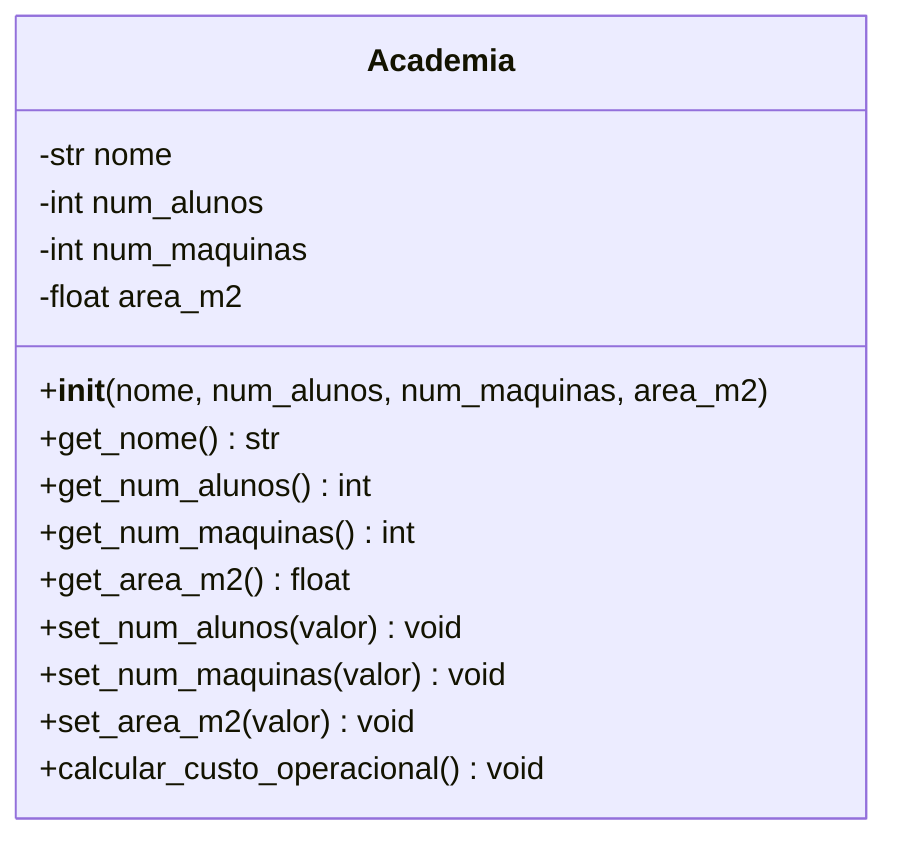

# 🏋️ Exercício 2 — Gestão de Academia

**Objetivo:** Praticar manipulação de listas de objetos (CRUD), busca por nome e cálculos de custo.

## Enunciado

Crie uma aplicação para gerenciar uma **rede de Academias (Ginásios)**.

- **Classe `Academia`:**
  - **Atributos:** `nome`, `num_alunos`, `num_maquinas`, `area_m2`.
  - **Métodos:** *getters*, *setters* e `calcular_custo_operacional()`:
    - Cada instrutor consegue atender até **25 alunos** (arredondando para cima, se necessário).
    - Cada instrutor recebe **2.000 € por mês**.
    - Cada máquina tem um custo de manutenção mensal de **50 €**.
    - O método deve exibir quantos instrutores são necessários e o custo total mensal (salários + manutenção das máquinas).

- **Funções do sistema (com menu em loop):**
  - `criar_academia()`: pede os dados, instancia o objeto e adiciona na lista.
  - `ver_academia()`: busca pelo nome; se encontrar, exibe os dados e chama `calcular_custo_operacional()`. Caso contrário, informa que não foi encontrada.
  - `modificar_academia()`: busca pelo nome e permite alterar `num_alunos`, `num_maquinas` ou `area_m2`.
  - `remover_academia()`: busca pelo nome e remove da lista (ou avisa se não existir).

  
📐 Ver Diagrama UML

