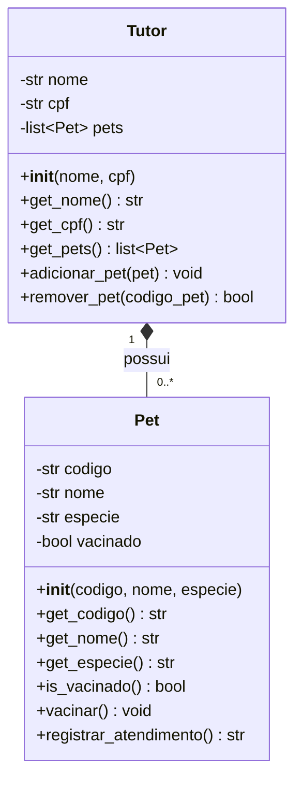

# 🐾 Exercício 3 — Clínica Veterinária

**Objetivo:** Praticar relacionamento entre duas classes (composição 1-para-N), menu interativo e controle de estado.

## Enunciado

Uma **Clínica Veterinária** precisa gerenciar seus tutores e os pets cadastrados.

- **Classe `Pet`:**
  - **Atributos:** `codigo`, `nome`, `especie`, `vacinado` (inicia como `False`).
  - **Métodos:** `vacinar()` (muda `vacinado` para `True`) e `registrar_atendimento()` (exibe/confirma se está vacinado ou não).

- **Classe `Tutor`:**
  - **Atributos:** `nome`, `cpf` (ou DNI), `pets` (lista que inicia vazia).
  - **Métodos:** `adicionar_pet(pet)` e `remover_pet(codigo_pet)`.

- **Regras e Menu:**
  - Um tutor pode ter vários pets, mas cada pet pertence a apenas um tutor.
  - Crie um menu interativo em loop com as opções:
    1. Cadastrar tutor.
    2. Remover tutor.
    3. Cadastrar pet e associar a um tutor existente.
    4. Vacinar um pet (buscando pelo código).
    5. Listar todos os pets de um tutor (mostrando quais estão vacinados).
    6. Sair.

  
📐 Ver Diagrama UML

