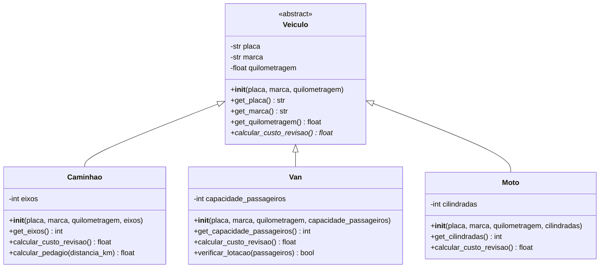

# 🚚 Exercício 4 — Frota de Veículos

**Objetivo:** Praticar classe base (não instanciada diretamente), herança, polimorfismo e métodos específicos por subclasse.

## Enunciado

Uma empresa de logística quer controlar sua **Frota de Veículos**. Não deve ser instanciado nenhum objeto da classe base `Veiculo`, apenas das subclasses: `Caminhao`, `Van` e `Moto`.

- **Classe base `Veiculo`:**
  - **Atributos comuns (somente leitura via *getters*):** `placa`, `marca`, `quilometragem`.
  - **Método `calcular_custo_revisao()`:** cada tipo de veículo calcula de um jeito (sobrescrito nas subclasses).

- **Subclasses e regras:**
  - **`Caminhao`:** possui o atributo adicional `eixos`. Custo de revisão = `500 €` base + `150 €` por eixo. Além disso, possui o método `calcular_pedagio(distancia_km)` que cobra `0,20 €` por km multiplicado pelo número de eixos.
  - **`Van`:** possui o atributo adicional `capacidade_passageiros`. Custo de revisão = `300 €` base + `20 €` por assento. Possui o método `verificar_lotacao(passageiros)` que garante não ultrapassar a capacidade.
  - **`Moto`:** possui o atributo adicional `cilindradas`. Custo de revisão = `120 €` se tiver até 250cc, ou `250 €` se tiver mais.

- **Aplicação:**
  - Menu para cadastrar veículo (escolhendo o tipo), mostrar todos os dados de um veículo pela placa (chamando todos os seus métodos) e remover veículo.

  
📐 Ver Diagrama UML

