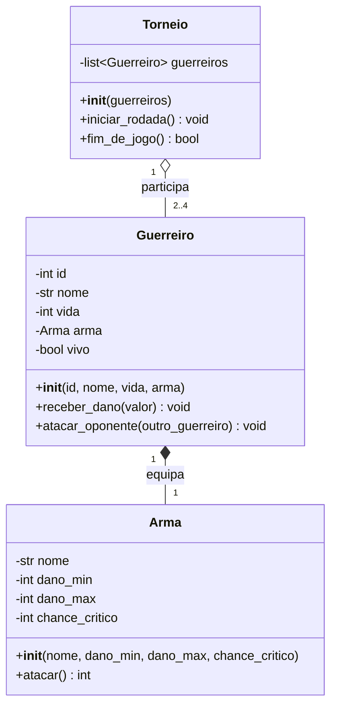

# ⚔️ Exercício 5 — Torneio de Duelo

**Objetivo:** Praticar controle de fluxo em turnos, aleatoriedade (`random`) e interação entre objetos.

## Enunciado

Crie um simulador de **Torneio de Duelo entre Guerreiros**.

- **Classe `Arma`:**
  - **Atributos:** `nome`, `dano_min`, `dano_max`, `chance_critico` (porcentagem de 0 a 100).
  - **Método `atacar()`:** gera um dano aleatório entre `dano_min` e `dano_max`. Se um sorteio de 1 a 100 cair dentro da `chance_critico`, o dano é dobrado (e deve informar que foi acerto crítico!).

- **Classe `Guerreiro`:**
  - **Atributos:** `id`, `nome`, `vida` (ex.: `100`), `arma` (objeto `Arma`), `vivo` (booleano).
  - **Métodos:** `receber_dano(valor)` e `atacar_oponente(outro_guerreiro)`.

- **Classe `Torneio`:**
  - Recebe uma lista de guerreiros (entre 2 e 4; se o usuário digitar fora desse intervalo, usar 2 por padrão).
  - **Método `iniciar_rodada()`:** em cada turno, os guerreiros vivos atacam o próximo guerreiro vivo da lista, imprimindo o log da batalha (quem atacou quem, dano causado, vida restante).
  - **Método `fim_de_jogo()`:** retorna `True` quando restar apenas 1 guerreiro vivo e anuncia o campeão.

  
📐 Ver Diagrama UML

