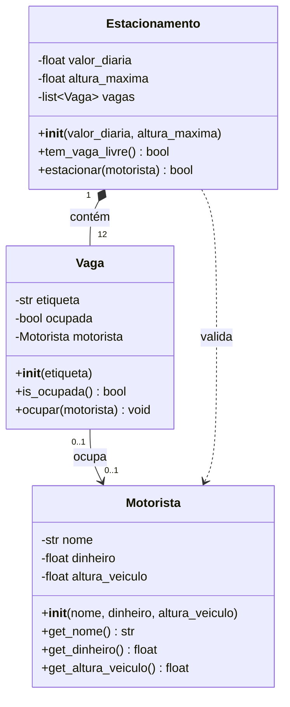

# 🅿️ Exercício 6 — Estacionamento Automatizado

**Objetivo:** Praticar matrizes/grades, geração aleatória de dados e busca por posição livre.

## Enunciado

Crie um simulador de **Estacionamento Automatizado** com uma única ala de vagas organizada em **3 filas por 4 colunas** (`1A` até `3D`).

- **Classe `Vaga`:**
  - Cada vaga tem uma etiqueta (`1A`, `1B`... `3D`) e um status (`ocupada`: `True/False`).
- **Classe `Estacionamento`:**
  - Armazena o valor da diária (ex.: `15 €`) e a altura máxima permitida (ex.: `2.2` metros).
- **Classe `Motorista`:**
  - Atributos: `nome`, `dinheiro`, `altura_veiculo` (ex.: entre `1.4` e `2.5` metros).

- **Simulação:**
  - Gere aleatoriamente entre **6 e 12 motoristas** com nomes, dinheiro e altura do veículo aleatórios.
  - Tente estacionar um por um em uma vaga sorteada aleatoriamente:
    - O motorista só pode estacionar se tiver **dinheiro suficiente**, se a **altura do veículo** for menor ou igual ao limite e se houver **vaga livre**.
    - Se a vaga sorteada já estiver ocupada, o sistema deve procurar outra vaga livre automaticamente.
  - Imprima no console cada passo da simulação (ex.: *"Tentando estacionar Carlos (altura 1.8m, 20€)..."*, *"Vaga 1B ocupada, buscando outra..."*, *"Estacionado na vaga 2C"* ou *"Não tem dinheiro suficiente"*).

  
📐 Ver Diagrama UML

---

**Solução:** [Ver código da solução](./solutions/06-estacionamento.py)

