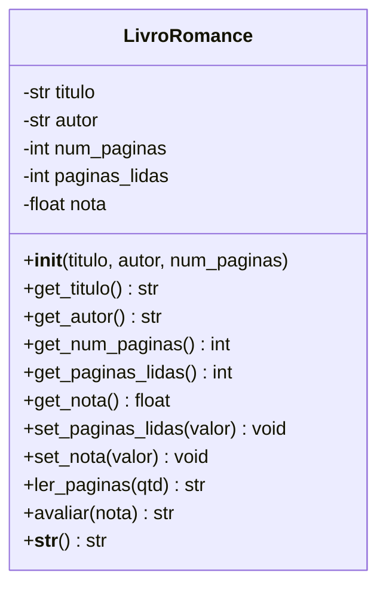

# 📖 Exercício 7 — Clube do Livro de Romance

**Objetivo:** Praticar criação de classe, encapsulamento (*getters/setters*), validações de estado e separação em módulos.

## Enunciado

Crie uma classe chamada `LivroRomance` em um arquivo chamado `livro_romance.py`.

- **Atributos:** `titulo`, `autor`, `num_paginas`, `paginas_lidas` (inicia em `0`) e `nota` (inicia como `None`).
- **Métodos:**
  - Construtor (`__init__`).
  - *Getters* para todos os atributos.
  - *Setters* para `paginas_lidas` (não pode ser negativo nem ultrapassar `num_paginas`) e `nota` (entre `0` e `5`).
  - `ler_paginas(qtd)`: soma `qtd` às `paginas_lidas` (respeitando o limite de `num_paginas`) e retorna uma string com a porcentagem concluída da leitura.
  - `avaliar(nota)`: só permite atribuir a nota se o livro já tiver sido 100% lido; caso contrário, retorna uma mensagem avisando que é preciso terminar a leitura antes de avaliar.
  - `__str__()`: retorna uma descrição completa do livro, progresso e avaliação.

No arquivo `main.py`, crie uma função `registrar_leituras()` que peça os dados de **2 livros de romance** ao usuário, instancie os objetos e teste a leitura e avaliação de ambos.

  
📐 Ver Diagrama UML

---

**Solução:** [Ver código da solução](./solutions/07-clube-romance/)

