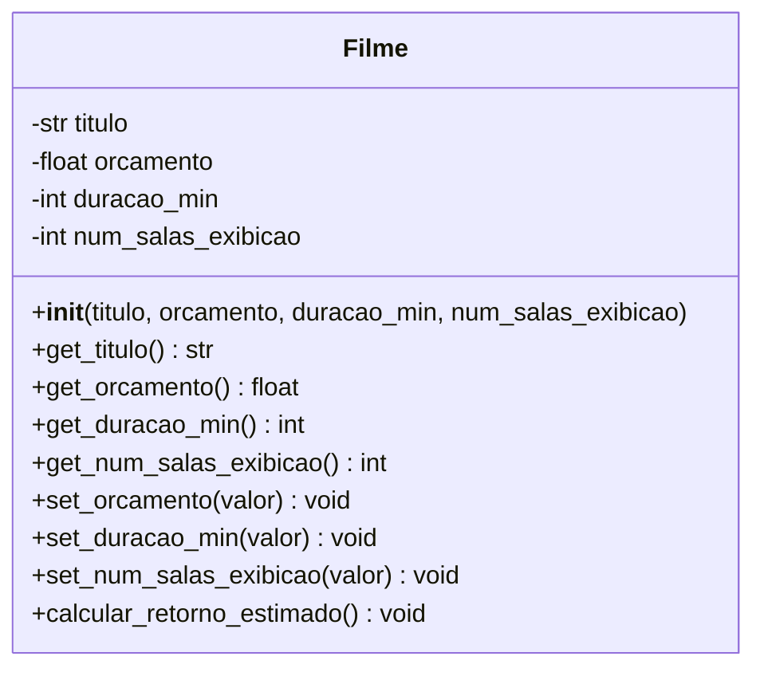

# 🎬 Exercício 8 — Produtora de Cinema

**Objetivo:** Praticar manipulação de listas de objetos (CRUD), busca por título e cálculos financeiros.

## Enunciado

Crie uma aplicação para gerenciar os lançamentos de uma **Produtora de Cinema**.

- **Classe `Filme`:**
  - **Atributos:** `titulo`, `orcamento`, `duracao_min`, `num_salas_exibicao`.
  - **Métodos:** *getters*, *setters* e `calcular_retorno_estimado()`:
    - Cada sala exibe **4 sessões por dia**, com média de **80 espectadores por sessão**.
    - O preço médio do ingresso é **12 €**.
    - Calcule a receita estimada da primeira semana (**7 dias**) e compare com o `orcamento`, exibindo a receita total e se o filme terá **lucro** ou **prejuízo** estimado (e de quanto).

- **Funções do sistema (com menu em loop):**
  - `cadastrar_filme()`: pede os dados, instancia o objeto e adiciona à lista.
  - `ver_filme()`: busca pelo título; se encontrar, exibe os dados e chama `calcular_retorno_estimado()`. Caso contrário, informa que não está no catálogo.
  - `modificar_filme()`: busca pelo título e permite alterar `orcamento`, `duracao_min` ou `num_salas_exibicao`.
  - `remover_filme()`: busca pelo título e remove da lista (ou avisa se não existir).

  
📐 Ver Diagrama UML

---

**Solução:** [Ver código da solução](./solutions/08-produtora-cinema.py)

