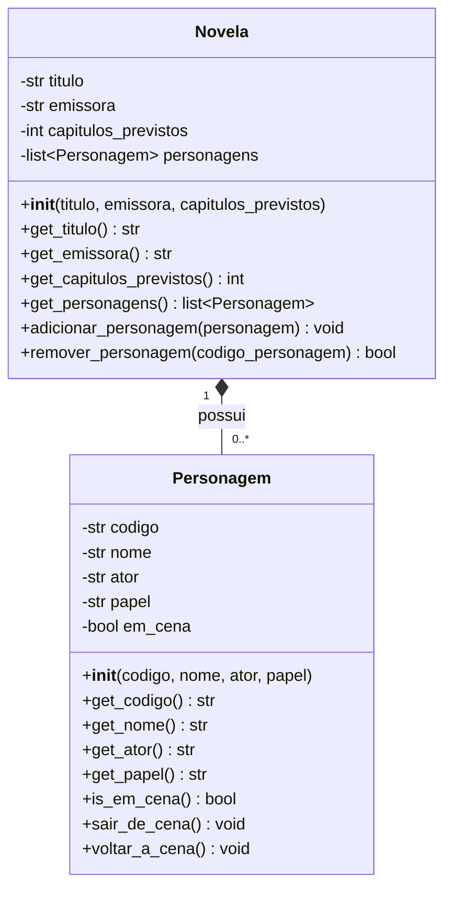

# 📺 Exercício 9 — Elenco de Novela

**Objetivo:** Praticar relacionamento entre duas classes (composição 1-para-N), menu interativo e controle de estado.

## Enunciado

Uma emissora de TV precisa gerenciar suas **Novelas** e os **Personagens** de cada trama.

- **Classe `Personagem`:**
  - **Atributos:** `codigo`, `nome`, `ator`, `papel` (ex.: `"Protagonista"`, `"Vilão"`, `"Coadjuvante"`), `em_cena` (inicia como `True`).
  - **Métodos:** `sair_de_cena()` (muda `em_cena` para `False`) e `voltar_a_cena()` (muda `em_cena` para `True`).

- **Classe `Novela`:**
  - **Atributos:** `titulo`, `emissora`, `capitulos_previstos`, `personagens` (lista que inicia vazia).
  - **Métodos:** `adicionar_personagem(personagem)` e `remover_personagem(codigo_personagem)`.

- **Regras e Menu:**
  - Uma novela pode ter vários personagens, mas cada personagem pertence a uma única novela.
  - Crie um menu interativo em loop com as opções:
    1. Cadastrar novela.
    2. Remover novela.
    3. Cadastrar personagem e associar a uma novela existente.
    4. Tirar ou retornar um personagem de cena (buscando pelo código).
    5. Listar o elenco de uma novela (separando quem está em cena e quem saiu da trama).
    6. Sair.

  
📐 Ver Diagrama UML

