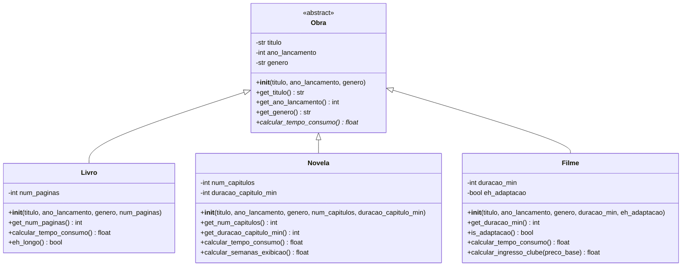

# 🎭 Exercício 10 — Catálogo de Adaptações

**Objetivo:** Praticar classe base (não instanciada diretamente), herança, polimorfismo e métodos específicos por subclasse.

## Enunciado

Uma plataforma de entretenimento quer catalogar **Obras** de romance e drama em diferentes formatos. Não deve ser instanciado nenhum objeto da classe base `Obra`, apenas das subclasses: `Livro`, `Novela` e `Filme`.

- **Classe base `Obra`:**
  - **Atributos comuns (somente leitura via *getters*):** `titulo`, `ano_lancamento`, `genero`.
  - **Método `calcular_tempo_consumo()`:** retorna o tempo total em horas para consumir a obra (sobrescrito nas subclasses).

- **Subclasses e regras:**
  - **`Livro`:** possui o atributo adicional `num_paginas`. `calcular_tempo_consumo()` considera **2 minutos por página** (retornando em horas). Possui o método `eh_longo()` que retorna `True` se tiver mais de 400 páginas.
  - **`Novela`:** possui os atributos adicionais `num_capitulos` e `duracao_capitulo_min`. `calcular_tempo_consumo()` retorna o total de horas para maratonar todos os capítulos. Possui o método `calcular_semanas_exibicao()` considerando **6 capítulos por semana**.
  - **`Filme`:** possui os atributos adicionais `duracao_min` e `eh_adaptacao` (booleano). `calcular_tempo_consumo()` retorna a duração em horas. Possui o método `calcular_ingresso_clube(preco_base)` que aplica **20% de desconto** se `eh_adaptacao` for `True`.

- **Aplicação:**
  - Menu para cadastrar obra (escolhendo o formato), consultar todos os dados pelo título (chamando todos os métodos da respectiva subclasse) e remover obra.

  
📐 Ver Diagrama UML

