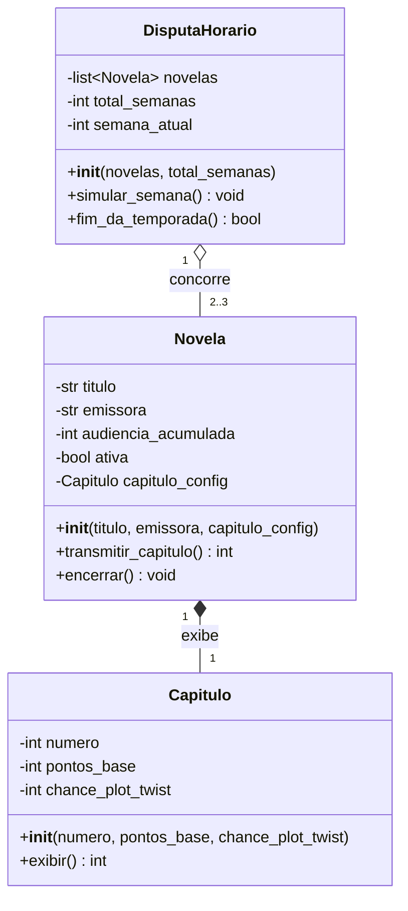

# 📈 Exercício 11 — Batalha de Audiência das Novelas

**Objetivo:** Praticar controle de fluxo por rodadas, aleatoriedade (`random`) e interação entre objetos.

## Enunciado

Crie um simulador de **Disputa de Audiência no Horário Nobre** entre novelas concorrentes.

- **Classe `Capitulo`:**
  - **Atributos:** `numero`, `pontos_base`, `chance_plot_twist` (porcentagem de `0` a `100`).
  - **Método `exibir()`:** gera uma audiência aleatória entre `pontos_base - 3` e `pontos_base + 5`. Se um sorteio de `1` a `100` cair dentro da `chance_plot_twist`, adiciona **+10 pontos** e informa que houve um *plot twist* bombástico!

- **Classe `Novela`:**
  - **Atributos:** `titulo`, `emissora`, `audiencia_acumulada` (inicia em `0`), `ativa` (booleano, inicia `True`), `capitulo_config` (objeto `Capitulo`).
  - **Métodos:** `transmitir_capitulo()` (soma a audiência gerada ao total e retorna os pontos do dia) e `encerrar()` (muda `ativa` para `False`).

- **Classe `DisputaHorario`:**
  - Recebe uma lista de novelas (entre `2` e `3`; se o usuário informar fora desse intervalo, usar `2` por padrão) e o número total de semanas da temporada (ex.: `6`).
  - **Método `simular_semana()`:** cada novela ativa exibe um capítulo, exibindo a pontuação da semana e o acumulado. Se alguma novela fizer menos de `15` pontos na semana, ela é cancelada (`encerrar()`).
  - **Método `fim_da_temporada()`:** retorna `True` quando todas as semanas forem concluídas ou quando restar apenas `1` novela no ar, anunciando a campeã de audiência.

  
📐 Ver Diagrama UML

