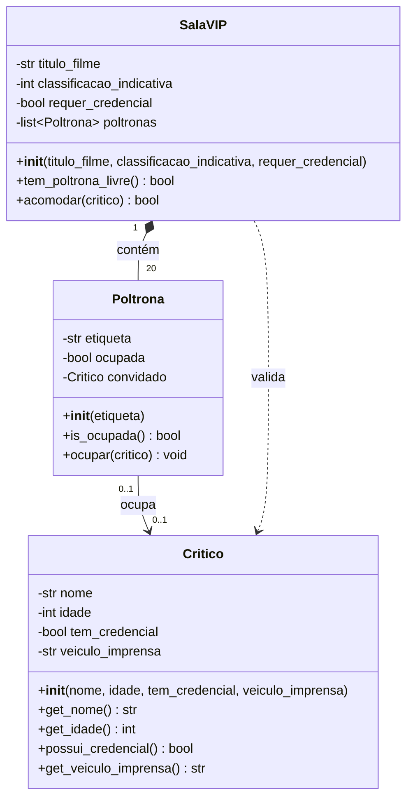

# 🎟️ Exercício 12 — Pré-estreia no Festival de Cinema

**Objetivo:** Praticar matrizes/grades, geração aleatória de dados e busca por posição livre.

## Enunciado

Crie um simulador de **Pré-estreia VIP em um Festival de Cinema** com uma sala organizada em **4 filas por 5 colunas** (`1A` até `4E`).

- **Classe `Poltrona`:**
  - Possui `etiqueta` (`1A`, `1B`... `4E`), status `ocupada` (`True/False`) e `convidado` (inicia `None`).
- **Classe `SalaVIP`:**
  - Armazena o `titulo_filme`, a `classificacao_indicativa` (ex.: `16` anos) e `requer_credencial` (booleano, ex.: `True`).
- **Classe `Critico`:**
  - Atributos: `nome`, `idade`, `tem_credencial` (`True/False`), `veiculo_imprensa`.

- **Simulação:**
  - Gere aleatoriamente entre **8 e 15 críticos/convidados** com nomes, idades, veículos e credenciais aleatórios.
  - Tente acomodar um por um em uma poltrona sorteada aleatoriamente:
    - O convidado só pode sentar se tiver **idade maior ou igual à classificação indicativa**, possuir **credencial** (caso a sessão exija) e houver **poltrona livre**.
    - Se a poltrona sorteada já estiver ocupada, o sistema deve procurar outra poltrona livre automaticamente.
  - Imprima no console cada passo da simulação (ex.: *"Acomodando Marina (22 anos, credencial: Sim)..."*, *"Poltrona 2C ocupada, buscando outra..."*, *"Sentada na poltrona 3A"* ou *"Entrada negada: sem credencial de imprensa"*).

  
📐 Ver Diagrama UML

---

**Solução:** [Ver código da solução](./solutions/12-festival-cinema.py)

